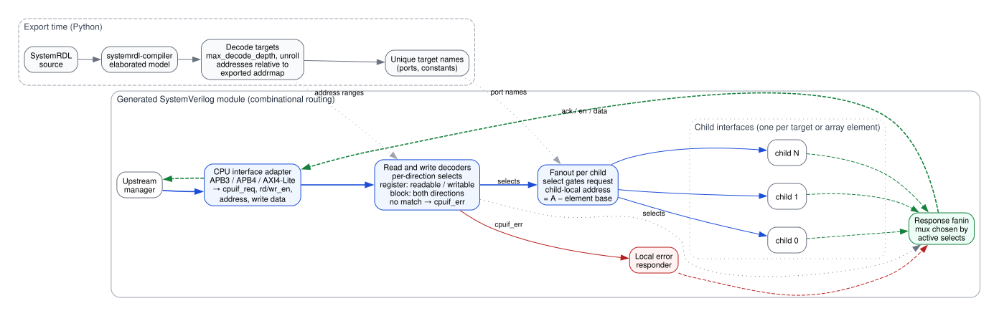
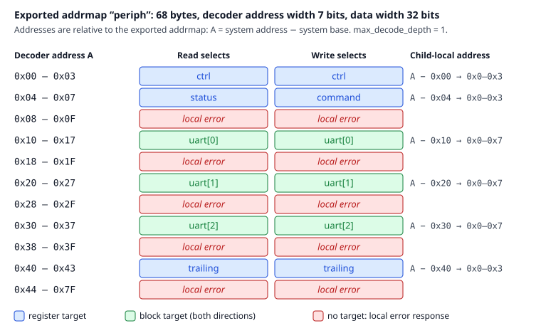

Bus Decoder Architecture
========================

The generated RTL is a bus-routing layer. It accepts a single CPU interface on
the slave side and fans transactions out to a set of child interfaces on the
master side. No user register or field logic is generated, though a protocol
adapter may include handshake buffers and ordering state.

Although you do not need to know the inner workings to use the exporter, the
sections below explain the structure of the generated module and how it maps to
SystemRDL hierarchy.

        names. The generated module adapts the upstream bus, decodes reads and
        writes separately, fans requests out to the selected child with a
        child-local address, and muxes the selected child's response back. An
        address with no target is answered by a local error responder.

    Export flow and generated module structure. Blue paths carry requests, dashed
    green paths carry responses, and red paths are locally generated errors.

For side-by-side diagrams of the structures emitted by command-line options,
see :ref:`generated_decoder_structure`.

CPU Interface Adapter
---------------------
Each supported CPU interface protocol (APB3, APB4, AXI4-Lite, AHB-Lite) provides
an adapter around the common read/write address decoders. APB holds a current
request through completion. AXI4-Lite retains accepted destinations and
payloads in independent read/write queues; both directions may decode in the
same cycle. AHB-Lite retains the accepted address-phase destination and
direction for the following data phase, independently of the live next address.

There is no global single-flight restriction. Queueing, acceptance, response
ordering, backpressure, and reset belong to the protocol adapter, not to the
combinational address-decode layer. Both directions use the same exported
SystemRDL layout; standalone custom read/write layouts are not implemented.

If you write a custom CPU interface, it must implement the internal signals
described in :ref:`cpuif_protocol`.

Address Decode
--------------
The address decoder computes per-child select signals based on address ranges.
The decode boundary is controlled by ``max_decode_depth``:

* ``0``: Decode down to addressable leaves, including registers and external memories
* ``1`` (default): Decode only top-level children
* ``N``: Decode down to depth ``N`` from the top-level

This allows you to choose whether the bus decoder routes to large blocks (e.g.,
child addrmaps) or to smaller sub-blocks.

Addressable leaves shallower than a positive depth limit remain routed targets;
the limit never requires a leaf to occur at exactly depth ``N``. See
:doc:`migrating` for the shallow-leaf change from 0.7.x.

Port collection, target naming, select generation, and fanout/fanin use the same
decode-boundary decision. A container whose addressable children are all external
remains an early boundary, preserving the existing treatment of opaque blocks.

When the decode boundary is a register, read requests select it only if a
present field is software-readable; write requests select it only if a present
field is software-writable. This separates legal read-only/write-only register
overlaps at one address. A disallowed direction returns a local unmapped error.
Block targets remain opaque address regions and forward both directions.

Decode bounds and downstream addresses are relative to the exported addrmap,
including when the Python API exports an inner addrmap with a nonzero system
base address. Array stride gaps select no child and return a local error rather
than waiting indefinitely for a downstream response.

The figure below is computed from an example design (see
``docs/diagrams/src/address_map.rdl``). It shows every decoder address range,
which target each direction selects, and the address forwarded to that child.

        are read/write registers. At 0x04 reads select the read-only status
        register and writes select the write-only command register. uart[0..2]
        are 8-byte blocks on a 16-byte stride, so 0x18, 0x28 and 0x38 start
        8-byte holes that return local errors, as do 0x08-0x0F and everything
        from 0x44 to the top of the 7-bit address space.

    Decoded address map at ``max_decode_depth = 1``: read/write overlap at
    0x04, array stride holes, and child-local addresses.

Fanout to Child Interfaces
--------------------------
For each decoded child, the bus decoder drives a master-side CPU interface.
All address, data, and control signals are forwarded to the selected child.

Arrayed children can be kept as arrays or unrolled into discrete interfaces using
``--unroll``. This only affects port structure and naming; decode semantics are
unchanged.

Target naming
~~~~~~~~~~~~~
A target keeps its local SystemRDL instance name when that name is unique among
the decoded targets. Uniqueness is checked after converting to uppercase, since
package constants and array-count localparams use uppercase identifiers.

When local names collide, the exporter uses the target's complete path relative
to the exported top-level addrmap, replacing hierarchy separators with
underscores. For example, ``blk_a.ctrl`` and ``blk_b.ctrl`` become
``blk_a_ctrl`` and ``blk_b_ctrl``. Existing unique local names are reserved first.
If flattened paths still collide with each other or with a reserved name,
``__2``, ``__3``, and so on are appended until the name is unique. These names
are allocated in sorted relative-path order, independently of traversal order.
Array indices are not part of this base identifier.
Generated package names are reserved too: a target named ``MIN`` receives a
suffix rather than colliding with ``<MODULE>_MIN_ADDR_WIDTH``.

The same resolved identifier is used for every built-in protocol's interface
and flat master ports, their fanout and fanin references, interface-array
intermediate signals, and ``<MODULE>_<TARGET>_ADDR_WIDTH`` package constants.
APB/AXI array-count localparams also use this identifier. Rolled ports include
all ancestor and target dimensions in outer-to-inner order. The internal select
structures retain hierarchical member paths; they are not flattened to match
the ports.

Fanin and Error Handling
------------------------
Read and write responses are muxed back from the retained selected child to the
slave interface. If no child is selected for a transaction, the decoder
generates an error response on the slave interface. Stateful protocols may
retain several selections and choose the response source from an order queue.

APB terminates local misses in the access phase with ``PSLVERR``. AXI4-Lite
queues local ``DECERR`` responses in normal per-direction order and passes
child ``RRESP/BRESP`` unchanged. AHB-Lite returns a local two-cycle ERROR
(``HREADYOUT/HRESP`` = ``0/1`` then ``1/1``) and muxes child responses only
from the retained data-phase destination. Idle requests leave selects and
decode errors zero. See the individual CPU-interface pages for timing,
reset, and integration assumptions.
