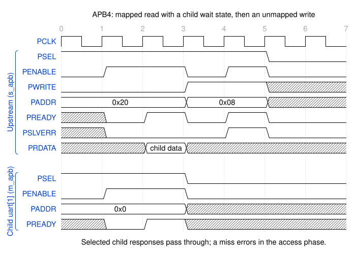

AMBA APB
========

Both APB3 and APB4 standards are supported.

With the default ``--apb-buffer none``, omitting ``--clk-src`` selects ``off``.
The unbuffered decoder preserves the clockless 0.7.x port shape: no
``clk``/``rst`` ports, no standalone ``PCLK``/``PRESETn`` ports, and no
clock/reset forwarding or sequential state. Explicit ``--clk-src off`` selects
the same behavior.

Opting into ``--clk-src design`` adds input ``clk``/``rst`` ports; flat APB
ports still omit ``PCLK``/``PRESETn``. With ``--clk-src cpuif``, flat variants
instead add upstream ``s_apb_PCLK``/``s_apb_PRESETn`` inputs and pass-through
clock/reset outputs for every child, without separate ``clk``/``rst`` ports.
These clock-source choices do not add latency to unbuffered APB.

The bundled SystemVerilog interfaces retain ``PCLK``/``PRESETn`` members.
Those members are inputs on both modports: connect every interface instance
externally to the same selected domain. The decoder neither uses nor forwards
them in ``off`` mode; ``design`` uses its separate input ports instead.
Buffered APB selects ``design`` automatically when the clock-source option is
omitted, as described below.

With ``--apb-buffer none``, an unmapped address completes with an error in the
first access cycle. The decoder asserts ``PREADY`` and ``PSLVERR`` together only
when ``PSEL`` and ``PENABLE`` are high; both remain low during setup and while
unselected.
Mapped transfers pass through the selected endpoint's response signals.

Back-to-back transfers may keep ``PSEL`` high, but each transfer requires a
SETUP phase with ``PENABLE`` low between ACCESS phases. These are individual
APB transfers, not bursts. With ``--apb-buffer none``, the decoder is
combinational and does not retain transactions; buffering is opt-in.

        0x0; the child holds PREADY low for one access cycle and the upstream
        PREADY follows it. A following write to the unmapped address 0x08
        selects no child and completes in its first access cycle with PREADY
        and PSLVERR high.

    APB4 through the decoder: a mapped read with a child wait state, then an
    unmapped write. APB3 behaves the same without ``PPROT``/``PSTRB``.

.. warning::
    Some IP vendors will incorrectly implement the address signalling
    assuming word-addresses. (that each increment of ``PADDR`` is the next word)

    For this exporter, values on the interface's ``PADDR`` input are interpreted
    as byte-addresses. (an APB interface with 32-bit wide data increments
    ``PADDR`` in steps of 4 for every word). Even though APB protocol does not
    allow for unaligned transfers, this is in accordance to the official AMBA
    specification.

    Be sure to double-check the interpretation of your interconnect IP. A simple
    bit-shift operation can be used to correct this if necessary.

APB3
----

Implements the bus decoder using an
`AMBA 3 APB <https://developer.arm.com/documentation/ihi0024/b/Introduction/About-the-AMBA-3-APB>`_
CPU interface.

The APB3 CPU interface comes in two i/o port flavors:

SystemVerilog Interface
    * Command line: ``--cpuif apb3``
    * Interface Definition: :download:`apb3_intf.sv <../../hdl-src/apb3_intf.sv>`
    * Class: :class:`peakrdl_busdecoder.cpuif.apb.APB3Cpuif`

Flattened inputs/outputs
    Flattens the interface into discrete input and output ports.

    * Command line: ``--cpuif apb3-flat``
    * Class: :class:`peakrdl_busdecoder.cpuif.apb.APB3CpuifFlat`

APB4
----

Implements the bus decoder using an
`AMBA 4 APB <https://developer.arm.com/documentation/ihi0024/d/?lang=en>`_
CPU interface.

APB4 managers must drive ``PSTRB`` to zero for reads. By default, writes
broadcast the manager's byte strobes directly to downstream interfaces;
``--gate-signals`` optionally masks the payload of unselected children.

The APB4 CPU interface comes in two i/o port flavors:

SystemVerilog Interface
    * Command line: ``--cpuif apb4``
    * Interface Definition: :download:`apb4_intf.sv <../../hdl-src/apb4_intf.sv>`
    * Class: :class:`peakrdl_busdecoder.cpuif.apb.APB4Cpuif`

Flattened inputs/outputs
    Flattens the interface into discrete input and output ports.

    * Command line: ``--cpuif apb4-flat``
    * Class: :class:`peakrdl_busdecoder.cpuif.apb.APB4CpuifFlat`

Broadcast Signal Gating
-----------------------

``PENABLE`` is always masked with each slave's select expression, so unselected
slaves hold it low. By default, the payload signals ``PADDR``, ``PWDATA``,
``PSTRB``, and ``PPROT`` fan out to every master port without select masking,
keeping the master-to-slave datapath free of extra mux stages. Conformant
slaves only sample these signals while their ``PSEL`` is asserted.

Passing ``--gate-signals`` also masks each payload signal with the slave's
select expression, so unselected slaves see all-zero payload inputs. This
costs one extra mux stage on the datapath, but reduces switching activity on
quiet sub-blocks (power/EMI), produces cleaner debug waveforms, and defends
against non-conformant slaves that latch inputs without checking ``PSEL``.
``PSEL``, ``PENABLE``, and ``PWRITE`` are unaffected by this option.

Transaction-Aware Buffering
---------------------------

``--apb-buffer`` selects request and response buffering around the APB decoder.
It is not an unconditional delay of the interface signals:

* ``none`` (default): the existing combinational request and response paths,
  without transaction state or added latency.
* ``in``: captures the request payload at the rising clock edge ending upstream
  SETUP (``PSEL && !PENABLE``), then holds it while issuing one downstream
  SETUP followed by ACCESS. The retained payload is ``PWRITE``, ``PADDR``,
  ``PWDATA``, and, for APB4, ``PSTRB`` and ``PPROT``. The response remains
  combinational during downstream ACCESS, so the child and upstream transfer
  complete on the same edge.
* ``out``: uses the live upstream payload, which the APB master must hold
  through completion, and forwards upstream SETUP/ACCESS to the selected child.
  At child completion it captures ``PRDATA``, ``PSLVERR``, and ready status,
  immediately removes downstream ``PSEL``/``PENABLE``, and holds the registered
  response until upstream ``PSEL && PENABLE && PREADY`` acceptance.
* ``both``: combines the retained request and registered response stages.

Every buffered mode tracks ownership of one transaction. A selected child
completes exactly once; retaining an upstream ACCESS while a registered response
is pending does not replay the child transfer. There are no multiple outstanding
transfers.

For a child with no wait states, timing measured at the upstream interface is:

.. list-table::
    :header-rows: 1

    * - Mode
      - ACCESS cycles through completion
      - Minimum cycles between completions
    * - ``none``
      - 1
      - 2
    * - ``in``
      - 2
      - 3
    * - ``out``
      - 2
      - 3
    * - ``both``
      - 3
      - 4

Completion spacing includes the mandatory upstream SETUP cycle between
back-to-back transfers, even when ``PSEL`` stays high. Each child wait cycle
adds one cycle to both counts. Unmapped requests use the same buffering stages
around the local ACCESS-phase error response.

Buffered modes require ``--clk-src design``. Omitting ``--clk-src`` selects it
automatically for ``in``, ``out``, and ``both``; explicit ``off`` or ``cpuif``
with buffering is rejected. Omit the clock-source option, select ``design``,
or use ``--apb-buffer none`` to return to unbuffered routing. Buffered modes
use design ``clk`` and active-high asynchronous ``rst``. Reset clears retained
request/response state, suppresses downstream requests and upstream ready, and
aborts a pending transfer. It cannot undo downstream side effects that already
completed.
After reset, the upstream master must restart with a fresh SETUP; a stale
ACCESS held across reset is not replayed. These reset rules apply to buffered
modes, not to the unchanged combinational ``none`` path.

Non-APB CPU interfaces reject non-``none`` buffering. Buffering does not change
the clock-distribution or ``--gate-signals`` contracts described above.
