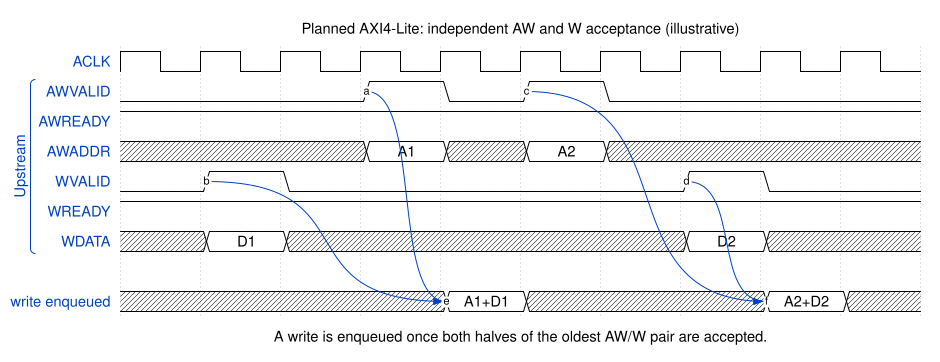

.. _cpuif_axi4lite:

AMBA AXI4-Lite
==============

Implements the bus decoder using an
`AMBA AXI4-Lite <https://developer.arm.com/documentation/ihi0022/e/AMBA-AXI4-Lite-Interface-Specification>`_
CPU interface.

The stateful ordering implementation is available in 0.8.0.

The AXI4-Lite CPU interface comes in two i/o port flavors:

SystemVerilog Interface
    * Command line: ``--cpuif axi4-lite``
    * Interface Definition: :download:`axi4lite_intf.sv <../../hdl-src/axi4lite_intf.sv>`
    * Class: :class:`peakrdl_busdecoder.cpuif.axi4lite.AXI4LiteCpuif`

Flattened inputs/outputs
    Flattens the interface into discrete input and output ports.

    * Command line: ``--cpuif axi4-lite-flat``
    * Class: :class:`peakrdl_busdecoder.cpuif.axi4lite.AXI4LiteCpuifFlat`

Clock and reset
---------------
AXI4-Lite always requires an operational clock/reset for its holding registers
and ordered-response queues. Omitting ``--clk-src`` (or using Python
``clk_src=None``) selects ``design`` and adds top-level ``clk`` and active-high
asynchronous ``rst`` inputs. ``--clk-src cpuif`` instead uses upstream
``ACLK``/``ARESETn`` without separate ``clk``/``rst`` ports. Flat ``cpuif``
variants expose those protocol inputs and pass-through outputs for each child;
SystemVerilog interface instances must receive the common clock/reset
externally. Explicit ``--clk-src off`` is rejected: omit the option or select
``design`` or ``cpuif`` and connect that source. See :doc:`introduction` for
wiring and :doc:`../migrating` for the change from the 0.7.4 AXI adapter.

Protocol behavior
-----------------
The adapter implements stateful AXI4-Lite handshakes in the read and write
directions independently.

* Upstream ``AW`` and ``W`` beats may arrive in either order. One holding
  register per channel retains them until they form a complete write request.
* Downstream ``AW``, ``W``, and ``AR`` ``VALID`` signals and payloads remain
  stable until the selected child asserts the corresponding ``READY``.
  Downstream ``AW`` and ``W`` handshakes are independent.
* Accepted requests retain their decoded destination and translated request
  payload. Changing the upstream address after its handshake cannot redirect
  an outstanding transaction.
* Reads and paired writes use separate bounded order queues. The default depth
  is four transactions per direction. When a queue is full, the corresponding
  upstream request ``READY`` is deasserted.
* Read responses are returned in ``AR`` acceptance order. Write responses are
  returned in completed ``AW``/``W`` pair order. A later, faster child cannot
  overtake an older response.
* ``RVALID/RDATA/RRESP`` and ``BVALID/BRESP`` remain stable while the upstream
  ``READY`` is low. Only the child that owns the response-queue head receives
  downstream ``RREADY`` or ``BREADY``.
* Child ``RRESP`` and ``BRESP`` values are propagated unchanged. Unmapped
  requests complete locally with ``DECERR`` (``2'b11``) in their normal FIFO
  position. A wider upstream SystemVerilog interface address with nonzero bits
  above the configured decoder address width also returns ``DECERR``, rather
  than aliasing a low mapped address. Flat upstream ports already have the
  configured width.
* Reset clears partial ``AW``/``W`` captures and both queues. All connected
  children must share the reset domain so abandoned responses cannot reappear
  as post-reset transactions.

AXI4-Lite is single-beat and has no transaction IDs. Reads and writes are
separate ordering domains: an ``R`` response and a ``B`` response have no
ordering relationship and may complete in the same cycle.

This is AXI4-Lite support, not full AXI4. AXI4 transaction IDs, bursts,
exclusive accesses, and cross-ID response reordering are not implemented.
Read and write channels share the exported SystemRDL layout; generating
standalone directional decoders from different layouts is not an exporter
option in this release.
AXI4-Lite standard data widths are 32 and 64 bits. Other generator-inferred
widths are implementation extensions, not a claim of AXI4-Lite compliance;
both endpoints must explicitly support the extension.

Write request acceptance
------------------------
The timing example below shows both arrival orders for ``AW`` and ``W``.
Each accepted pair records its destination (or a local-error marker), so a
later address never redirects an older response. Timing diagrams are
illustrative; exact latencies depend on the implementation and the children.

        once A1 arrives. Address A2 is accepted before its data D2; that pair
        is enqueued once D2 arrives.

    ``AW`` and ``W`` may arrive in either order or on different cycles.

Outstanding depth
-----------------
Set the queue capacity with ``--axi4lite-max-outstanding`` on the command line:

.. code-block:: console

    peakrdl busdecoder design.rdl -o out \
        --cpuif axi4-lite --axi4lite-max-outstanding 8

The equivalent Python exporter keyword is ``axi4lite_max_outstanding``. Values
must be at least one. The depth applies separately to accepted reads and paired
writes; the default is four.

.. _cpuif_axi4lite_backpressure:

Handshake and back-pressure details
-----------------------------------
Request dispatch is FIFO within each direction. This is stricter than routing
requests to different children in parallel, but it keeps destination and
response association unambiguous without AXI IDs. Once dispatched, multiple
children may have responses pending concurrently.

Response ordering intentionally creates head-of-line blocking. If child B has
a response ready for a later request while older child A is still pending, B's
``READY`` remains low. AXI requires B to retain its ``VALID`` and payload. Once
A's response handshakes upstream, B becomes the queue head and can proceed.

The one-entry ``AW`` and ``W`` holding registers favor simple, deterministic
control over maximum write-channel throughput. A channel is not re-accepted
while its holding register is occupied. Read and write traffic otherwise make
progress independently.

See :ref:`cpuif_axi4lite_response_ordering` for the ordering contract,
microarchitecture, and sequence diagrams.
