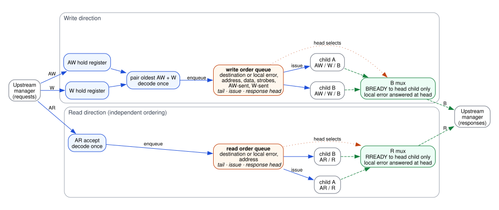
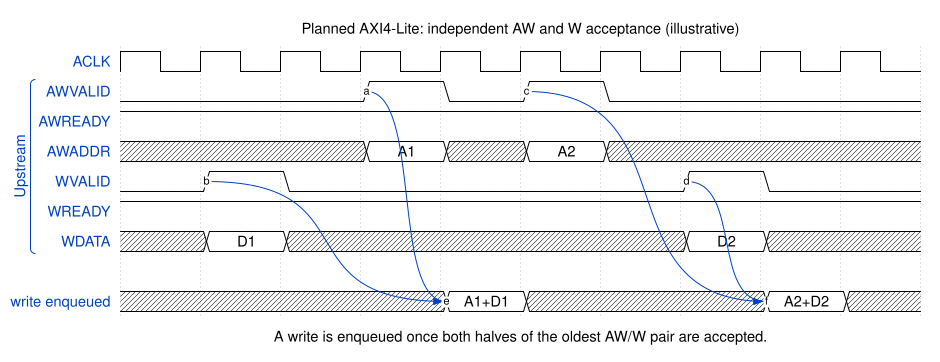
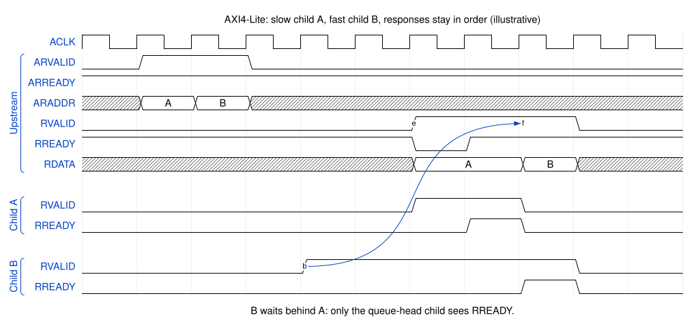
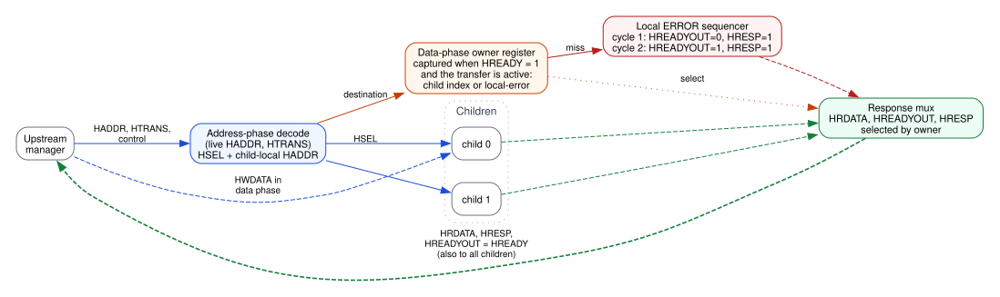
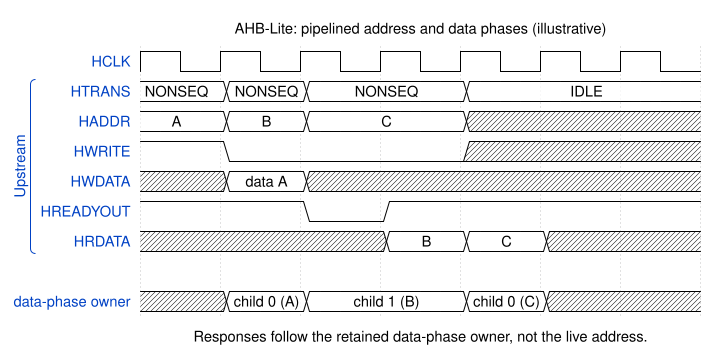
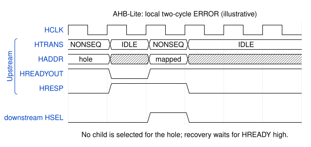

Upcoming CPU Interfaces
=======================

.. warning::
    The behavior on this page is **not in any released version**. It documents
    designs under review so their architecture can be discussed before they ship.
    Released AXI4-Lite behavior is described in :ref:`cpuif_axi4lite`.

The figures use the same conventions as :doc:`../architecture`: blue paths carry
requests, dashed green paths carry responses, red marks locally generated
errors, and orange marks state retained per transaction. Timing diagrams are
illustrative; exact latencies depend on the implementation and the children.

Ordered AXI4-Lite
-----------------
Proposed in `PR #83 <https://github.com/arnavsacheti/PeakRDL-BusDecoder/pull/83>`_.

The adapter requires a clock/reset: omitting ``--clk-src`` selects ``design``;
explicit ``cpuif`` is also supported, while ``off`` is rejected.

The adapter accepts ``AW`` and ``W`` independently, keeps separate read and write
order queues, and allows several transactions per direction to be outstanding.
Each accepted transaction records its destination (or a local-error marker) when
it is accepted, so a later address never redirects an older response.

        once and enqueues into the write order queue. The queue issues requests
        to children; the B mux passes BREADY only to the child at the queue head
        and answers local errors when they reach the head. The read path has its
        own AR decode, read order queue and R mux, ordered independently of writes.

    Ordered AXI4-Lite structure: independent read and write queues.

AXI4-Lite has no transaction IDs, so responses in one direction must return in
acceptance order. Children may become ready in any order; a faster child waits
until older transactions complete.

        once A1 arrives. Address A2 is accepted before its data D2; that pair
        is enqueued once D2 arrives.

    ``AW`` and ``W`` may arrive in either order or on different cycles.

        RREADY low. Child A responds later; its response is presented upstream
        and held while upstream RREADY is low. After A's handshake, child B
        receives RREADY and B's response follows.

    Same-direction ordering: child B's earlier response waits behind A, and the
    presented response stays stable under upstream back-pressure.

AHB-Lite
--------
Implemented on the ``feature/ahb-lite-isolated`` branch; not yet proposed for
merge.

The adapter always uses ingress ``HCLK/HRESETn``. ``--clk-src design`` and
``--clk-src cpuif`` are accepted but ignored; explicit ``off`` is rejected.
No accepted setting adds generic ``clk``/``rst`` or child clock/reset outputs.

AHB-Lite overlaps the address phase of one transfer with the data phase of the
previous one. The decoder therefore separates live address-phase selection from
a registered **data-phase owner** that alone selects the response.

        address. The destination is captured into the data-phase owner register
        when HREADY is high. The owner selects the response mux, or starts the
        local two-cycle ERROR sequencer for a miss. Write data reaches children
        during the data phase. The muxed HREADYOUT is returned upstream and fed
        back as HREADY to all children.

    AHB-Lite structure: combinational address phase, registered data-phase owner.

        state, and C a read from child 0. Each data phase follows its address
        phase by one cycle; during B's wait state the owner stays child 1 and
        the address of C is held. Read data for B and C come from their owners.

    Pipelined phases: the response follows the data-phase owner, and write data
    is forwarded in its data phase.

        with HREADYOUT low and HRESP high, then HREADYOUT high and HRESP high.
        The next mapped address is accepted while HREADY is high.

    An unmapped address receives the required two-cycle ``ERROR`` response.
